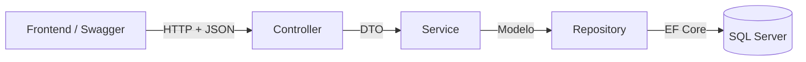
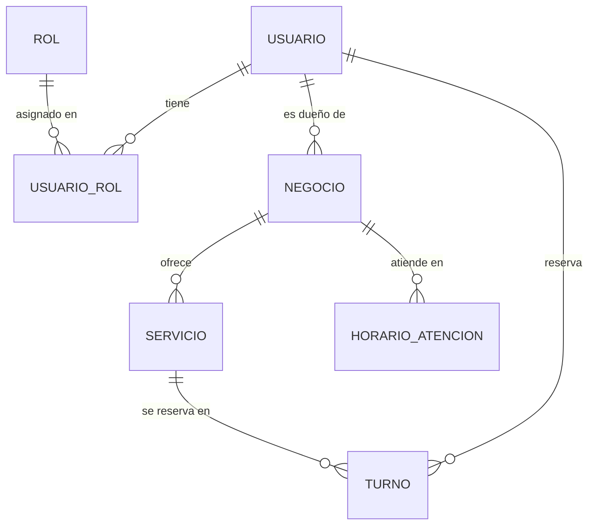
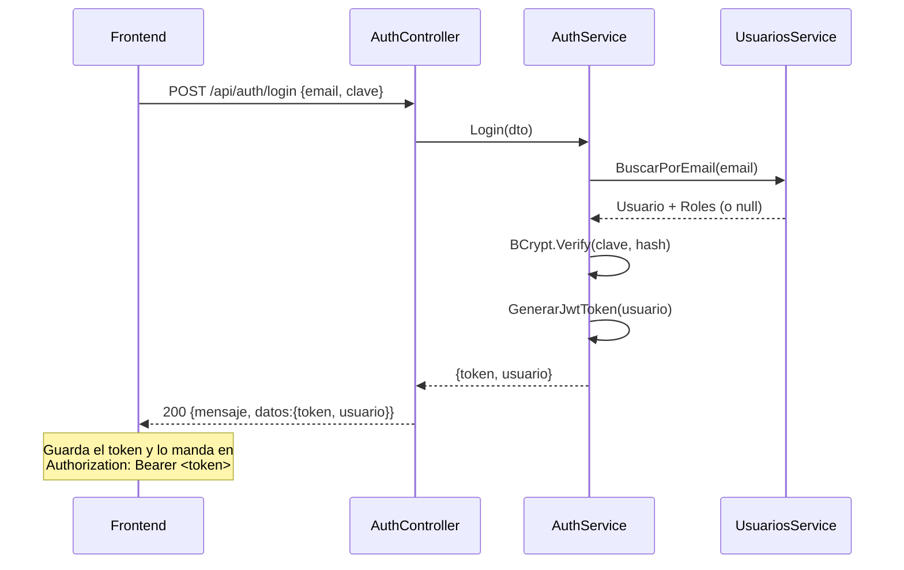

# Backend — cómo está armado

Este documento explica qué hace el backend, cómo viaja una petición por el código y cómo agregar un módulo nuevo siguiendo el mismo patrón.

## Índice

1. [Arquitectura en capas](#1-arquitectura-en-capas)
2. [Carpetas y archivos](#2-carpetas-y-archivos)
3. [Modelo de datos](#3-modelo-de-datos)
4. [Formato de las respuestas](#4-formato-de-las-respuestas)
5. [Autenticación y autorización](#5-autenticación-y-autorización)
6. [Endpoints disponibles](#6-endpoints-disponibles)
7. [Probar con Swagger](#7-probar-con-swagger)
8. [Cómo agregar un módulo nuevo](#8-cómo-agregar-un-módulo-nuevo)
9. [Migraciones](#9-migraciones)
10. [Errores comunes](#10-errores-comunes)

---

## 1. Arquitectura en capas

Cada petición atraviesa siempre las mismas capas, y cada capa tiene una sola responsabilidad:



| Capa | Responsabilidad | No debería |
|---|---|---|
| **Controller** | Recibir la petición, llamar al service y transformar el resultado o el error en una respuesta HTTP | Tener lógica de negocio ni tocar el `DbContext` |
| **Service** | Reglas de negocio: validaciones, permisos de dueño, armado de entidades y DTOs | Saber de HTTP (salvo lanzar `RespuestaError` con un código) |
| **Repository** | Leer y escribir en la base | Tener reglas de negocio |
| **DTO** | Definir qué entra y qué sale de la API, con sus validaciones | Exponer campos sensibles (como la clave) |

Ejemplo: `POST /api/auth/register`

1. `AuthController.Register` recibe un `CrearUsuarioDTO`. Si falla alguna validación (`[Required]`, `[EmailAddress]`, etc.), ASP.NET responde **400** sin entrar al método.
2. Llama a `UsuariosService.CrearUno(dto)`, que:
   - normaliza el email (minúsculas, sin espacios),
   - revisa que no exista (`_repo.Existe`) y, si existe, lanza `RespuestaError(400)`,
   - busca el rol `User`, hashea la clave con BCrypt y crea el `Usuario`,
   - devuelve un `UsuarioDTO` (sin la clave).
3. El controller lo envuelve en `RespuestaExito(201)` y responde.

### Referencias que seguimos

| Tema | De dónde sale |
|---|---|
| Capas, DI, DTOs, migraciones, JWT, CORS, Swagger | Teoría de la cátedra: [`02-backend/guia`](https://github.com/atarico/UNT-programacion4/tree/main/02-backend/guia) |
| Repositorio genérico con `includes`, `Respuesta` / `RespuestaExito` / `RespuestaError`, `try/catch` en los controllers, baja lógica con `IsActivo` en el `PUT` | Práctica de clase: `panaderiaApi` |
| Mapeo entidad → DTO en `Mapping/Mapper.cs` | Teoría, capítulo 3 |
| Migraciones aplicadas al arrancar (`Database.Migrate()`) | Teoría, capítulo 4 |

**Manejo de errores.** Seguimos la práctica de la panadería: el service lanza `RespuestaError` con su código HTTP y cada acción del controller lo atrapa con `try/catch`. La teoría (capítulo 6) muestra la alternativa de un filtro global (`GlobalExceptionFilter`) que hace lo mismo sin repetir el `try/catch`: es un buen tema para comentar en la defensa.

---

## 2. Carpetas y archivos

```
backend/
├── Program.cs                 Arranque: servicios, JWT, Swagger, CORS, DB
├── appsettings.json           Config compartida (conexión por defecto, JWT)
├── appsettings.Development.json  Conexión personal (NO se sube)
├── Config/
│   └── AppDbContext.cs        Tablas, relaciones, índices y datos iniciales
├── Models/                    Entidades = tablas de la base
├── Enums/
│   ├── ROL.cs                 Constantes "Admin" / "User"
│   └── EstadoTurno.cs         Pendiente / Confirmado / Cancelado / Completado
├── Dtos/                      Objetos de entrada y salida de la API
├── Repositories/
│   └── Repository.cs          Repositorio genérico IRepository<T>
├── Mapping/
│   └── Mapper.cs              Entidad → DTO con métodos de extensión (ToNegocioDTO, ...)
├── Services/                  Lógica de negocio
├── Controllers/               Endpoints HTTP
├── Utils/
│   ├── Respuestas/            Formato estándar de respuesta y errores
│   ├── Filters/               Candado de Swagger en endpoints protegidos
│   └── Extensions/            User.ObtenerUsuarioId()
└── Migrations/                Historial de cambios del esquema (generado por EF)
```

### `Program.cs`

Registra todo lo que la app necesita, en este orden:

- **Controllers + JSON:** los enums viajan como texto (`"Pendiente"` en lugar de `0`) y se ignoran los ciclos de navegación (Negocio → Servicios → Negocio...).
- **Swagger** con el esquema de seguridad `token` (Bearer JWT).
- **Autenticación JWT:** valida firma y vencimiento del token con el `JWT:Secret`.
- **CORS:** permite peticiones desde `http://localhost:5173` (Vite).
- **Inyección de dependencias:** services y un `IRepository<T>` por entidad. Los repositorios de Negocio, Servicio, HorarioAtencion y Turno **ya están registrados**, listos para usar.
- **DbContext** con la cadena `dbDev`.

Swagger solo se habilita en Development.

### `Repository.cs` — repositorio genérico

Un solo repositorio sirve para todas las entidades:

| Método | Uso |
|---|---|
| `ObtenerTodos(filtro?, includes?)` | Lista, con filtro y relaciones opcionales |
| `ObtenerUno(filtro?, includes?)` | Primer registro que cumple el filtro, o `null` |
| `Existe(filtro)` | `true` / `false` (no trae datos) |
| `CrearUno(entidad)` | Inserta y guarda |
| `ActualizarUno(entidad)` | Actualiza y guarda |
| `EliminarUno(entidad)` | Borra y guarda |

Ejemplo con relaciones:

```csharp
var negocio = await _repo.ObtenerUno(
    n => n.Id == id,
    includes: [n => n.Servicios, n => n.Horarios]
);
```

> Sin `includes`, las listas de navegación vuelven vacías. Si un DTO necesita `Roles` o `Servicios`, hay que incluirlos.

---

## 3. Modelo de datos

Diagrama completo en [`DER_Turnero.pdf`](../DER_Turnero.pdf).



| Tabla | Para qué sirve | Notas |
|---|---|---|
| `Usuarios` | Cuentas de la plataforma | `Email` único; `Clave` guardada como hash BCrypt |
| `Roles` | `Admin` (staff) y `User` | Nombre único |
| `UsuarioRol` | Relación N:M Usuario ↔ Rol | PK compuesta (`UsuarioId`, `RolId`) |
| `Negocios` | El turnero de un comerciante | `UsuarioId` = dueño; `IsActivo` para baja lógica |
| `Servicios` | Lo que ofrece un negocio | `DuracionMinutos` define el largo del turno; `Precio` decimal(10,2) |
| `HorariosAtencion` | Tramos de atención por día | `DiaSemana` 0 = domingo … 6 = sábado; varios tramos por día permitidos |
| `Turnos` | Reservas | `ClienteId` → Usuario; `Estado` guardado como texto; índice en (`ServicioId`, `FechaHoraInicio`) |

### Reglas de borrado

| Si se borra... | Pasa con... |
|---|---|
| Un usuario | Se borran sus negocios (y en cascada sus servicios y horarios) y sus filas en `UsuarioRol` |
| Un negocio | Se borran sus servicios y horarios |
| Un servicio o usuario **con turnos** | **Se bloquea** (`Restrict`). SQL Server no permite dos caminos de cascada hacia `Turnos`, y además no queremos perder el historial |

Por eso, para "eliminar" un negocio o servicio desde la app conviene usar la **baja lógica** (`IsActivo = false`).

### Datos iniciales (seed)

| Qué | Valores |
|---|---|
| Roles | `1 = Admin`, `2 = User` |
| Usuario admin | `admin@turnoya.com` / `Admin1234`, con roles Admin y User |

### Por qué se guarda `FechaHoraFin` en el turno

Aunque se podría calcular (inicio + duración del servicio), tenerla guardada simplifica la validación de doble reserva. Un turno nuevo **choca** con uno existente del mismo servicio si:

```
nuevoInicio < existenteFin  &&  nuevoFin > existenteInicio
```

(ignorando los turnos `Cancelado`).

---

## 4. Formato de las respuestas

**Todas** las respuestas tienen la misma forma (`Utils/Respuestas/Respuesta.cs`):

```json
{
  "mensaje": "Texto para mostrar",
  "datos": { }
}
```

- **Éxito:** el service devuelve el dato y el controller arma `new RespuestaExito(mensaje, código, datos)`.
- **Error esperado:** el service lanza `throw new RespuestaError("mensaje", HttpStatusCode.X)`. El controller lo atrapa y responde con ese código; `datos` va en `null`.
- **Error inesperado:** cae en el `catch (Exception)` y responde **500** con el mensaje de la excepción.

Patrón de cada acción del controller:

```csharp
try
{
    var resultado = await _service.Algo(...);
    var exito = new RespuestaExito("Mensaje", HttpStatusCode.OK, resultado);
    return StatusCode((int)exito.CodigoEstado, exito.Res);
}
catch (RespuestaError error)
{
    return StatusCode((int)error.CodigoEstado, error.Res);
}
catch (Exception error)
{
    return StatusCode(StatusCodes.Status500InternalServerError, new Respuesta(error.Message));
}
```

> Los errores de validación de los DTO (400 automático de ASP.NET) **no** usan este formato. Vienen como `ProblemDetails`, con los mensajes en `errors`.

---

## 5. Autenticación y autorización

### Flujo de login



- Si el email no existe **o** la clave es incorrecta, la respuesta es la misma: `400 Credenciales invalidas`. Así no se revela qué emails están registrados.
- El token dura `JWT:ExpiracionMinutos` (120 minutos).

### Qué lleva el token (claims)

| Claim | Valor | Para qué |
|---|---|---|
| `Id` | Id del usuario | Saber quién hace la petición |
| `NameIdentifier` | Email | Referencia |
| `Role` | Un claim por rol (`Admin`, `User`) | `[Authorize(Roles = ...)]` |

### Cómo proteger endpoints

| Atributo | Quién puede entrar |
|---|---|
| (ninguno) | Cualquiera, sin token |
| `[Authorize]` | Cualquier usuario logueado |
| `[Authorize(Roles = ROL.ADMIN)]` | Solo staff |
| `[AllowAnonymous]` | Abre un endpoint dentro de un controller protegido |

### Regla clave: los permisos de comerciante se validan por dueño, no por rol

No existe un rol "Comerciante". Para que solo el dueño pueda editar su negocio, el **service** compara el dueño con el usuario del token:

```csharp
// En el controller
int usuarioId = User.ObtenerUsuarioId();
await _service.ActualizarUno(id, dto, usuarioId);

// En el service
var negocio = await ObtenerUnoPorId(id);
if (negocio.UsuarioId != usuarioId)
    throw new RespuestaError("No tenés permiso sobre este negocio", HttpStatusCode.Forbidden);
```

`User.ObtenerUsuarioId()` está en `Utils/Extensions/ClaimsPrincipalExtensions.cs`.

---

## 6. Endpoints disponibles

| Método | Ruta | Acceso | Body | Devuelve en `datos` |
|---|---|---|---|---|
| POST | `/api/auth/register` | Público | `CrearUsuarioDTO` | `UsuarioDTO` (201) |
| POST | `/api/auth/login` | Público | `LoginDTO` | `{ token, usuario }` |
| GET | `/api/auth/me` | Logueado | — | `UsuarioDTO` del token |
| PUT | `/api/auth/roles/{usuarioId}` | Admin | `{ "rolesIds": [1, 2] }` | `UsuarioDTO` actualizado |
| GET | `/api/usuarios` | Admin | — | Lista de `UsuarioDTO` |
| GET | `/api/usuarios/roles` | Admin | — | Lista de roles |
| GET | `/api/negocios/mios` | Logueado | — | Mis negocios (con sus servicios) |
| GET | `/api/negocios/{id}` | Dueño | — | `NegocioDTO` |
| POST | `/api/negocios` | Logueado | `CrearNegocioDTO` | `NegocioDTO` (201) |
| PUT | `/api/negocios/{id}` | Dueño | `ActualizarNegocioDTO` (campos opcionales; `isActivo: false` = baja lógica) | `NegocioDTO` |
| GET | `/api/negocios/{negocioId}/servicios` | Dueño | — | Lista de `ServicioDTO` (activos e inactivos) |
| POST | `/api/negocios/{negocioId}/servicios` | Dueño | `CrearServicioDTO` | `ServicioDTO` (201) |
| PUT | `/api/servicios/{id}` | Dueño | `ActualizarServicioDTO` (campos opcionales; `isActivo: false` = baja lógica) | `ServicioDTO` |
| POST | `/api/turnos` | Logueado | `CrearTurnoDTO` | `TurnoDTO` (201) |
| GET | `/api/turnos/mios` | Logueado | — | Mis turnos, los más nuevos primero |
| PUT | `/api/turnos/{id}/confirmar` | Dueño | — | `TurnoDTO` (pasa de Pendiente a Confirmado) |
| PUT | `/api/turnos/{id}/cancelar` | Cliente del turno o dueño del negocio | — | `TurnoDTO` |
| GET | `/api/negocios/{negocioId}/turnos?fecha=2026-11-12` | Dueño | — | Agenda del negocio (`fecha` opcional) |
| GET | `/api/catalogo/negocios?busqueda=&rubro=` | Público | — | Negocios activos con sus servicios activos |
| GET | `/api/catalogo/negocios/{id}` | Público | — | Detalle de un negocio activo |
| GET | `/api/catalogo/rubros` | Público | — | Lista de rubros (texto) |

"Dueño" = el usuario logueado tiene que ser el dueño del negocio; si no, responde **403**.

### Reglas de los turnos (decididas por el grupo)

| # | Regla | Dónde se configura |
|---|---|---|
| 1 | Al reservar, el turno queda `Pendiente`; el dueño lo pasa a `Confirmado` | `PUT /api/turnos/{id}/confirmar` |
| 2 | Las fechas viajan en **hora local, sin zona horaria**: `"2026-11-12T10:00:00"` (sin `Z`) | — |
| 3 | El turno empieza en la grilla del negocio: cada `IntervaloTurnosMinutos` desde las 00:00 (con 30: 9:00, 9:30, 10:00…) | Negocio, por defecto 30 |
| 4 | Ni en el pasado ni más allá de `DiasMaxAnticipacion` días | Negocio, por defecto 30 |
| 5 | El cliente cancela hasta `HorasToleranciaCancelacion` horas antes; después solo cancela el dueño | Negocio, por defecto 2 |
| 6 | El dueño puede reservar en su propio negocio | — |
| 7 | Un turno ocupa a **todo el negocio**: no puede haber dos turnos superpuestos, aunque sean de servicios distintos. Los cancelados no cuentan | — |

La duración del turno es la `DuracionMinutos` del servicio. Las tres configuraciones del negocio van en `CrearNegocioDTO` y `ActualizarNegocioDTO` (opcionales) y siempre vuelven con valor en `NegocioDTO`.

**Decisión técnica:** se eligió hora local en lugar de UTC porque la app opera en una sola zona horaria (Argentina). Pasar a UTC queda como mejora futura.

### Ejemplos

**Registro** — `POST /api/auth/register`

```json
{
  "nombre": "Ana",
  "apellido": "Pérez",
  "email": "ana@mail.com",
  "clave": "secreta123",
  "telefono": "3364000000"
}
```

Validaciones: nombre y apellido de 2 a 60 caracteres, email válido, clave de al menos 6 caracteres, teléfono opcional.

**Login** — `POST /api/auth/login`

```json
{ "email": "ana@mail.com", "clave": "secreta123" }
```

Respuesta:

```json
{
  "mensaje": "Bienvenido!",
  "datos": {
    "token": "eyJhbGciOi...",
    "usuario": {
      "id": 2,
      "nombre": "Ana",
      "apellido": "Pérez",
      "email": "ana@mail.com",
      "telefono": "3364000000",
      "fechaRegistro": "2026-11-01T21:00:00Z",
      "roles": ["User"]
    }
  }
}
```

`UsuarioDTO` **nunca** incluye la clave.

---

## 7. Probar con Swagger

1. Ejecutar el backend y abrir `https://localhost:7142/swagger`.
2. `POST /api/auth/login` con el admin (`admin@turnoya.com` / `Admin1234`) y copiar el `token` de la respuesta.
3. Botón **Authorize** (arriba a la derecha): pegar **solo el token**, sin escribir "Bearer".
4. Los endpoints con candado ya responden. Probar `GET /api/auth/me`.

---

## 8. Cómo agregar un módulo nuevo

Receta usando **Negocios** como ejemplo. Vale igual para Servicios, Horarios y Turnos.

1. **Modelo:** ya existe en `Models/Negocio.cs`. Si cambiás campos, ver el paso 7.
2. **DTOs** en `Dtos/Negocio/`:
   - `CrearNegocioDTO`: campos obligatorios con `[Required]`, `[MinLength]`, `[MaxLength]`.
   - `ActualizarNegocioDTO`: todos los campos opcionales (`string?`, `bool?`). Solo se actualiza lo que llega.
   - `NegocioDTO`: lo que se devuelve. Su mapeo va en `Mapping/Mapper.cs` (`negocio.ToNegocioDTO()`).
3. **Service** en `Services/NegociosService.cs`:
   - recibe `IRepository<Negocio>` por constructor,
   - métodos `ObtenerTodos`, `ObtenerUnoPorId` (con `404` si no existe), `CrearUno(dto, usuarioId)`, `ActualizarUno(id, dto, usuarioId)`, `EliminarUno(id, usuarioId)`,
   - en editar, validar que `negocio.UsuarioId == usuarioId` (si no, `403`). La baja es lógica: `IsActivo` en el DTO de actualización.
4. **Registrar el service** en `Program.cs`:
   ```csharp
   builder.Services.AddScoped<NegociosService>();
   ```
   El repositorio ya está registrado.
5. **Controller** en `Controllers/NegociosController.cs`:
   - `[Route("api/[controller]")]`, `[ApiController]`,
   - los listados públicos sin `[Authorize]`; crear, editar y borrar con `[Authorize]`,
   - mismo patrón `try/catch` de la sección 4,
   - documentar códigos con `[ProducesResponseType(...)]`.
6. **Probar en Swagger.**
7. **Si tocaste un modelo:** `Add-Migration NombreDescriptivo` y luego `Update-Database`.

Los módulos de negocios, servicios, turnos y catálogo ya siguen esta receta: usarlos como ejemplo.

---

## 9. Migraciones

Las migraciones son el historial de cambios de la base. Viven en `Migrations/` y **se suben al repo**.

| Situación | Comando (Consola del Administrador de paquetes, proyecto `backend`) |
|---|---|
| Recién cloné el repo o hice pull de una migración nueva | Nada: la API aplica las migraciones al arrancar. `Update-Database` también sirve |
| Cambié un modelo o el `AppDbContext` | `Add-Migration NombreDescriptivo` y luego `Update-Database` |
| Generé una migración y todavía no la apliqué ni la subí | `Remove-Migration` |
| Quiero volver la base a una migración anterior | `Update-Database NombreMigracion` |

Migraciones actuales:

| Migración | Qué hace |
|---|---|
| `inicial` | Crea las 7 tablas, relaciones, índices y el seed (roles + admin) |
| `ConfigTurnos` | Agrega a `Negocios` la configuración de turnos: intervalo, anticipación máxima y tolerancia de cancelación |

Reglas del equipo:

- Una sola persona por vez genera migraciones sobre el mismo modelo, y avisa al grupo.
- La migración se commitea **junto** con el cambio del modelo.
- Nunca editar a mano una migración que ya está en `main`.

---

## 10. Errores comunes

| Síntoma | Causa probable | Solución |
|---|---|---|
| `A network-related or instance-specific error...` | La cadena de conexión no encuentra tu SQL Server | Revisar `appsettings.Development.json`: nombre de la PC e instancia (`PC\\SQLEXPRESS`, con barra doble) |
| `Add-Migration` falla con `Build failed` | El proyecto no compila | Compilar (Ctrl+Shift+B) y corregir la Lista de errores |
| `dotnet ef` no se reconoce | Falta la herramienta global | Usar la Consola del Administrador de paquetes, o `dotnet tool install --global dotnet-ef` |
| 401 en un endpoint con candado | No se mandó el token, o venció (120 min) | Volver a loguearse y usar **Authorize** |
| 403 | El token es válido, pero no tiene el rol requerido | Usar un usuario con ese rol (por ejemplo, el admin) |
| `Credenciales invalidas` con el admin | La base se creó con otro seed | Verificar que la migración `inicial` esté aplicada |
| Error de CORS desde el front | El front no corre en `http://localhost:5173` | Usar ese puerto o agregar el origen en `Program.cs` |
| `Roles` vacío en una respuesta | Falta el `includes` en la consulta | Agregar `includes: [u => u.Roles]` |
